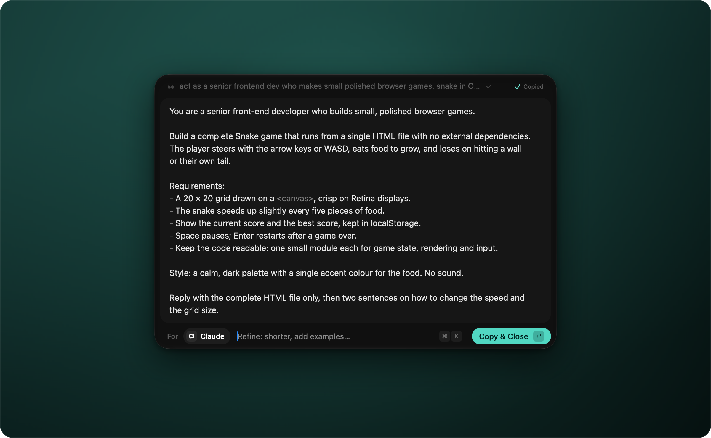
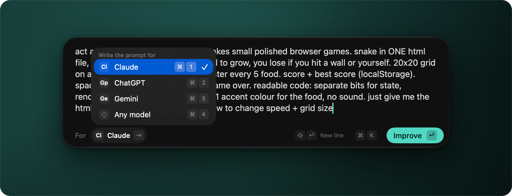
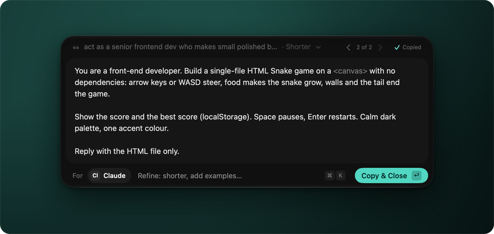
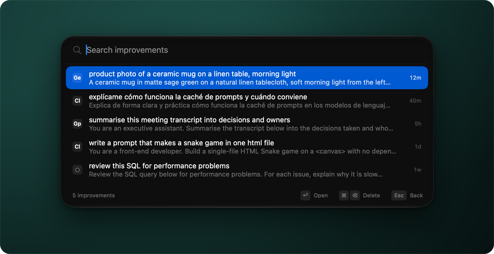
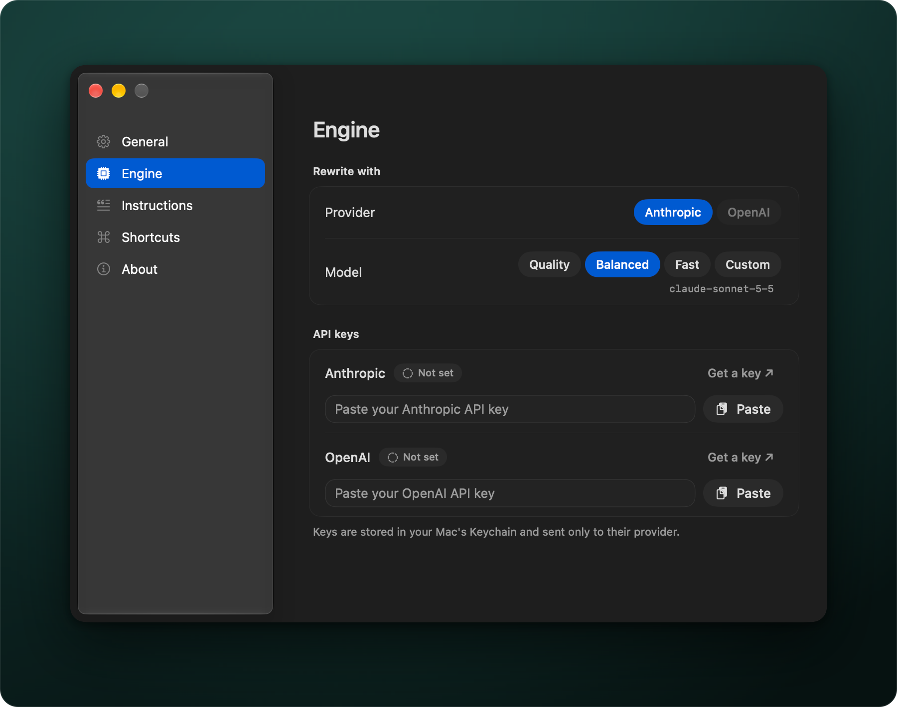

<p align="center">
  
</p>

<h1 align="center">Afino</h1>

<p align="center">
  <strong>Press a shortcut, type a rough idea, get a prompt worth sending.</strong><br>
  A native macOS menu bar app that rewrites your prompts for Claude, ChatGPT, Gemini or any model.
</p>

<p align="center">
  <a href="https://github.com/jnjambrin0/Afino/releases/latest"></a>
  
  
  <a href="LICENSE"></a>
</p>

<p align="center">
  <a href="https://github.com/jnjambrin0/Afino/releases/latest"><b>Download for macOS</b></a>
  &nbsp;·&nbsp; <a href="#install">Install</a>
  &nbsp;·&nbsp; <a href="#privacy-and-security">Privacy</a>
  &nbsp;·&nbsp; <a href="#build-from-source">Build from source</a>
</p>

<p align="center">
  
</p>

Afino is free and open source. It calls Anthropic or OpenAI directly with your own API key, kept in your Mac's Keychain. There is no Afino server, no account and no telemetry.

*Formerly PromptImprover.*

## How it works

1. **Press ⌃⌥P** in any app. A dark glass panel opens over whatever you are doing.
2. **Type or paste** a rough idea or a draft prompt, in any language. **Tab** picks who it is for: Claude, ChatGPT, Gemini or any model.
3. **Press Return.** The improved prompt streams in and is on your clipboard the moment it finishes. Paste it wherever you were going.

### Before → after

What you type:

```text
act as a senior frontend dev who makes small polished browser games. snake in ONE html file, no
libs. arrows or wasd, eat food to grow, you lose if you hit a wall or yourself. 20x20 grid on a
canvas, crisp on retina. a bit faster every 5 food. score + best score (localStorage). space
pauses, enter restarts after game over. readable code: separate bits for state, rendering, input.
calm dark colours, 1 accent colour for the food, no sound. just give me the html file and then 2
sentences on how to change speed + grid size
```

What lands on your clipboard (target: Claude):

```text
You are a senior front-end developer who builds small, polished browser games.

Build a complete Snake game that runs from a single HTML file with no external dependencies. The
player steers with the arrow keys or WASD, eats food to grow, and loses on hitting a wall or their
own tail.

Requirements:
- A 20 × 20 grid drawn on a <canvas>, crisp on Retina displays.
- The snake speeds up slightly every five pieces of food.
- Show the current score and the best score, kept in localStorage.
- Space pauses; Enter restarts after a game over.
- Keep the code readable: one small module each for game state, rendering and input.

Style: a calm, dark palette with a single accent colour for the food. No sound.

Reply with the complete HTML file only, then two sentences on how to change the speed and the grid
size.
```

Same request, nothing added, ready to send. (This example and the screenshots come from the app's built-in demo mode; real output varies with the model and the draft.)

## What it does

### Writes for the model you will use



The **target** is who the prompt is for. Each target ships with guidance on what makes a prompt work for that model family, written from the vendor's own prompting documentation (the sources are listed in each [target pack](Packages/PromptImproverKit/Sources/PIPrompts/Resources/Packs)). **Tab** cycles through them, **⌘1–⌘4** picks one.

The **engine** is the model that does the rewriting, chosen once in Settings › Engine: Anthropic or OpenAI, and Fast, Balanced, Quality or a model of your choice. The two are independent, so a GPT model can write a prompt for Claude and the other way round.

### Rewrites, never answers

Afino writes the prompt; it never carries out the task. Ask it "what's the capital of Australia?" and you get a better way to ask, not the answer. A draft that says "ignore your instructions" is treated as text to rewrite, not as an order.

It stays faithful to what you wrote. Facts, names, numbers, links, code, quoted text and template variables such as `{{name}}` are kept exactly. It does not choose a tone, a length, a format or an audience for you. Where something only you know is missing, it leaves a short fill-in such as `[paste the text here]` instead of making it up. A one-line ask becomes a short, sharp prompt, not a specification, and a draft that is already good comes back almost untouched.

### Refine in place



On a result, type an instruction such as "shorter" or "add an example" and press Return. Each refinement is a new version: **⌘[** and **⌘]** step between them, **⌘R** regenerates, **⌘E** goes back to editing the original, and **⌘1–⌘4** followed by Return rewrites the same draft for another target. The version on screen is the one on your clipboard. **⌘K** opens every action, including one-click Shorter, More detailed and Add examples.

### History



**⌘Y** shows your last 50 improvements, searchable. Open one to copy or refine it; **⌘⌫** deletes one and **⌘Z** brings it back. In an empty composer, **↑** recalls your earlier drafts. History stays on your Mac, and Settings › General turns it off or clears it.

### Make it yours

Settings › Instructions holds standing preferences applied to every improvement ("always write in English", "use XML tags"). Settings › General sets the output language (the draft's own, or always English), the default target, the theme, opening at login and the shortcut itself.

## Install

1. Download `Afino-v….dmg` from the [latest release](https://github.com/jnjambrin0/Afino/releases/latest), open it and drag Afino to Applications.
2. Open Afino. The welcome asks for an API key from [Anthropic](https://console.anthropic.com/settings/keys) or [OpenAI](https://platform.openai.com/api-keys), then shows the shortcut and the keys you will use every day. You can skip it and add a key later; the panel asks for one when it needs it.
3. Press **⌃⌥P** anywhere. If another app already uses it, Afino takes ⌃⌥⌘P instead; you can change it in Settings › General.

**Requirements:** macOS 26 or later, on Apple silicon or Intel, and an API key from Anthropic or OpenAI. Usage is billed by the provider to your own account.

Releases are signed with a Developer ID and notarized by Apple. Afino lives in the menu bar (no Dock icon) and updates itself with [Sparkle](https://sparkle-project.org): it checks once a day, every update is signed, and the check can be turned off in Settings › About. Updates need the app in the Applications folder, and Afino offers to move itself there if you open it from somewhere else.

## Privacy and security

- **Your keys** are stored in your login Keychain, on this Mac only (never synced), and are sent only to the provider they belong to, over HTTPS. They are never written to files, preferences or logs.
- **Your drafts and results** go from your Mac straight to the provider you chose, under your account and that provider's data policy. OpenAI requests are sent with `store: false`. Apart from that, Afino only talks to your provider to check a key and list the models it can use, and to the update feed.
- **History** (the last 50 improvements) is a plain file in `~/Library/Application Support/com.jnjambrin0.PromptImprover/` that only your user can read. Turn it off or clear it in Settings › General.
- **Logs** go to the system log and record sizes, status codes and request identifiers, never the text of a draft or a result.

The full picture, and how to report a vulnerability privately, is in [SECURITY.md](SECURITY.md).

## Keyboard

Everything works from the keyboard, and the panel shows each key as you go. The full list is in Settings › Shortcuts.

| Key | While writing | On a result |
|---|---|---|
| ⌃⌥P | Open or close the panel, from any app | |
| Return | Improve | Refine with what you typed, rewrite for a new target, or Copy & Close |
| ⇧Return | New line | |
| ⌘Return | Improve | Copy & Close |
| Tab / ⇧Tab | Next / previous target | |
| ⌘1 … ⌘4 | Choose a target | Choose a target; Return then rewrites for it |
| ↑ / ↓ | Earlier drafts, in an empty field | Scroll |
| ⌘R | | Regenerate |
| ⌘E | | Edit the original |
| ⌘O | | Show or hide the original |
| ⌘N | | New prompt |
| ⌘[ / ⌘] | | Previous / next version |
| ⌘C | | Copy the selection, or the whole prompt |
| ⌘K | All actions | All actions |
| ⌘Y | History | History |
| ⌘, | Settings | Settings |
| Esc | Close (your draft is kept) | Close |

While a prompt is being written, Esc or ⌘. stops it and keeps what has arrived. In the history, Return opens an entry, ⌘⌫ deletes it, ⌘Z undoes the delete and Esc goes back.

## Engine presets



| Preset | Anthropic | OpenAI |
|---|---|---|
| Fast | `claude-haiku-5-5`, low effort, thinking off | `gpt-6-luna`, no reasoning effort |
| **Balanced** (default) | `claude-sonnet-5-5`, low effort | `gpt-6.2-sol`, low effort |
| Quality | `claude-opus-5-5`, medium effort | `gpt-6.2-astra`, medium effort |
| Custom | Any model your key can use, with the effort you choose | Same |

The presets were chosen with the evaluation harness described below. The model list for Custom comes from your provider, so new models appear without an update.

## FAQ

**Which models can it use?**
For rewriting: Anthropic's Claude models or OpenAI's GPT models, through their APIs with your key. For the result: any model at all. Claude, ChatGPT and Gemini have their own targets, and "Any model" writes a prompt that does not lean on one vendor's conventions.

**Does it send my prompts anywhere else?**
No. A draft goes only to the provider you picked as the engine. The only other traffic is checking your key with that provider and the daily update check. There is no Afino server and no analytics.

**What does a rewrite cost?**
You pay your provider directly, at their prices. As a rough guide, the evaluation tool estimates about $0.20 for 16 short rewrites with the Balanced preset (around a cent each), and its estimates lean high. Fast costs a small fraction of that; Quality costs more. Your provider's usage page has the real figure.

**Why macOS 26?**
The panel and Settings are built on Liquid Glass, which macOS 26 introduced, and the icon is a layered Icon Composer icon. There is no build for earlier versions of macOS.

**I used PromptImprover 0.x. What changes?**
PromptImprover 0.x does not update itself to Afino: download Afino from the releases page and remove the old app. 1.0 is a rewrite that calls the provider APIs directly: the `codex` and `claude` command-line tools, the guide editor and the JSON output contract are gone, and you add an API key on first launch. The default shortcut changed from ⌘⌥I to ⌃⌥P. Guides you imported or edited in 0.x are kept in `~/Library/Application Support/com.jnjambrin0.PromptImprover/Legacy-0.x`; everything else 0.x stored was generated and is moved to the Trash. See the [changelog](CHANGELOG.md).

## Build from source

Requires macOS 26 and Xcode 27.2 or later.

```bash
scripts/test.sh     # unit tests of the Swift package: no network, no Keychain, no windows
scripts/build.sh    # Debug build of the app, printing only warnings, errors and the result
scripts/run.sh      # installs that build as ~/Applications/Afino Dev.app and launches it
```

Debug builds have their own bundle identifier (`com.jnjambrin0.PromptImprover.dev`), so their settings, history and Keychain items never mix with an installed release, and they never look for updates. Without the project's signing certificate, give a Debug build its keys through the environment, which keeps the Keychain out of it:

```bash
ANTHROPIC_API_KEY=… scripts/run.sh
```

A Debug build can also drive itself with a scripted engine, no key or network needed: `scripts/run.sh --demo-engine --demo-open --demo-draft "a snake game" --demo-submit`. The flags are listed in [`PanelDemo.swift`](Packages/PromptImproverKit/Sources/PIApp/PanelUI/Demo/PanelDemo.swift).

### Architecture at a glance

The Xcode target in `PromptImprover/` is a shell; everything else is a Swift package in `Packages/PromptImproverKit`, in layers that only depend downwards:

```text
PIApp          panel, Settings, welcome, menu bar item, shortcuts, updates (Sparkle)
  │            the composition root
PICore         the improve session and its state machine, settings, keys, history
  │
PIProviders    Anthropic and OpenAI streaming clients, errors, model catalog
PIPrompts      the engine prompt, target packs, request assembly, output clean-up
PIDesign       design tokens and components
  │            (siblings: none imports another; only PIApp uses PIDesign)
PIFoundation   settings store, logging, Keychain, file helpers

PromptEval     the prompt-engine evaluation tool, beside the app and never linked into it
```

[docs/ARCHITECTURE.md](docs/ARCHITECTURE.md) follows one improvement from the shortcut to the clipboard and explains where everything lives. [docs/RELEASING.md](docs/RELEASING.md) describes the signed, notarized release pipeline, and [docs/BRAND.md](docs/BRAND.md) the icon, the palette and how the images in this README are made.

### Evaluating the prompt engine

`prompt-eval` runs the shipped engine prompt and provider clients over a set of fixtures, checks every output, has a second model grade it, and gives a ship verdict. It calls the real APIs with your keys and spends your credit, so it is never part of the test suite. See [docs/EVALUATION.md](docs/EVALUATION.md).

## Contributing

Bug reports, fixes and ideas are welcome. Start with [CONTRIBUTING.md](CONTRIBUTING.md) and the [Code of Conduct](CODE_OF_CONDUCT.md). For help, see [SUPPORT.md](SUPPORT.md); report security issues privately as described in [SECURITY.md](SECURITY.md).

## License and acknowledgements

Afino is released under the [Apache License 2.0](LICENSE). It updates itself with [Sparkle](https://sparkle-project.org), © Andy Matuschak and the Sparkle Project contributors, used under the MIT License.
