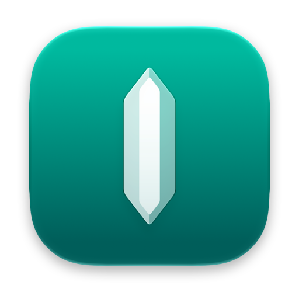
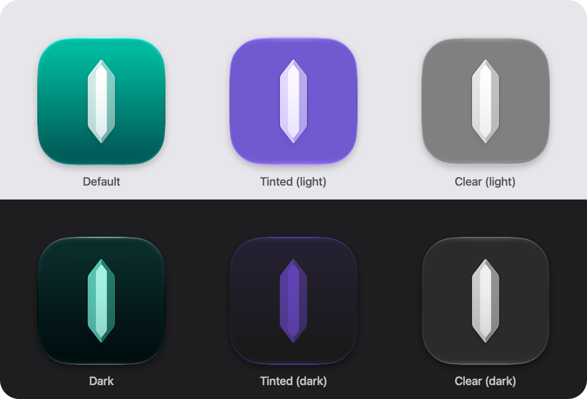

# Afino brand



## Concept

Afino turns rough words into a sharp prompt, right at the cursor. Its mark is **the caret cut into a crystal**: the insertion point where a loose idea becomes clear, faceted and exact. The colour is **aquamarine**, the stone the crystal is cut from, and it is used sparingly, so it always means "this is where your writing happens".

The in-app caret, the "Copied" check, the menu bar glyph and the icon tell the same story. The caret breathes while the model thinks, writes the prompt, and settles as a check.

## Palette: Aquamarine

One hue, about 181° in OKLCH, in every role. It sits about 75° away from the system blue (about 255°), so it never reads as selection or focus; those keep following the user's accent colour. An orchid and a pale glacier blue were tried and set aside: the orchid read as playful, and the blue, in light mode, as the system accent.

The accent has three jobs: the single primary button (what Return does), the caret, and the "Copied" check. It also colours the icon. It is never used for text, selection, focus rings or links.

| Token (`EmberDesign.Brand`) | Role | Dark (the panel) | Light (Settings) | Increase Contrast, dark | Increase Contrast, light |
|---|---|---|---|---|---|
| `accent` | Primary button fill | `#51D7C2` | `#006459` | `#51D7C2` (unchanged) | `#006459` (unchanged) |
| `onAccent` | Label and key caps on the button | `#02201E` | `#FFFFFF` | `#02201E` | `#FFFFFF` |
| `accentMark` | Thin marks: the 2 pt caret, the "Copied" check | `#6BE6D2` | `#007467` | `#A5F3E4` | `#00534A` |
| pressed (derived) | `accent` with `Control.pressedBrightness` (−0.06) | ≈ `#40C6B2` | ≈ `#005A50` | n/a | n/a |

The fill stays the same under Increase Contrast because it already passes AAA; only the thin marks get stronger. Primary buttons do not change on hover, like system buttons. The tokens are defined in [`EmberDesign+Brand.swift`](../Packages/PromptImproverKit/Sources/PIDesign/Tokens/EmberDesign+Brand.swift).

**Contrast** (WCAG 2.x relative luminance). Dark glass is measured as `#1E1E1E` and `#2C2C2E`; the light window as `#FFFFFF` and `#ECECEC`.

| Pair | Ratio |
|---|---|
| `onAccent` on `accent`, dark (`#02201E` on `#51D7C2`) | **9.65 : 1** (AAA) |
| `onAccent` on `accent`, light (`#FFFFFF` on `#006459`) | **7.08 : 1** (AAA) |
| Label on the pressed fill, dark / light | 8.09 / 8.14 : 1 |
| `accent` against dark glass / the light window | 9.41 and 7.86 / 7.08 and 5.99 : 1 |
| `accentMark` dark (`#6BE6D2`) on dark glass | 11.01 / 9.21 : 1 |
| `accentMark` light (`#007467`) on white / `#ECECEC` | 5.68 / 4.81 : 1 |
| `accentMark` Increase Contrast, dark (`#A5F3E4`) / light (`#00534A`) | 13.13 and 10.98 / 8.99 and 7.61 : 1 |

**Icon colours** (in [`design/generate-icons.swift`](../design/generate-icons.swift)):

- Default tile: `#00B89E` → `#005E5A`. The system's lighting renders it at about `#00C3AE` → `#006F6C`. Crystal facets are white at 100 / 82 / 52 % (centre / left / right).
- Dark tile: `#0A2D2B` → `#010E10`. Crystal facets are `#A5F3E4` / `#6BE6D2` / `#40C6B2`.

## App icon

`PromptImprover/AppIcon.icon` is an Icon Composer document, the layered Liquid Glass format of macOS 26. Xcode compiles it into `Assets.car` (an image stack for the light, dark and tinted appearances) and an `AppIcon.icns` fallback, under the name in `ASSETCATALOG_COMPILER_APPICON_NAME` (`AppIcon`).

- **Canvas:** 1024 × 1024, square layers, no mask, no baked shadows, glows or highlights. The system applies the rounded rectangle and the Liquid Glass. The Dock shows the tile at 824/1024 with the system shadow.
- **One group, three SVG layers**, numbered back to front: `1-facet-right`, `2-facet-left`, `3-facet-center`. The group uses `lighting: combined` (one glass object, no shadows between facets), `specular: true`, a neutral shadow at 50 % and translucency at 25 %.
- **Geometry:** a vertical hexagonal crystal, 220 × 684 px, centred (67 % of the canvas height, like first-party glyphs), 142 px from each apex to its shoulder.
  - Outer vertices are rounded at r = 20, so light can travel along the edges.
  - The silhouette is split exactly on the axis, so each apex is one curve.
  - The centre facet (the caret) is 88 px wide. It starts 46 px below each apex, which leaves a ridge, and its edges are parallel to the outer ones (r = 10).
- **Appearances:** Default (aqua tile, white crystal) and Dark (ink tile, aquamarine crystal) are set through `fill-specializations`. The system derives Tinted and Clear from the artwork.



## Menu bar glyph

`PromptImprover/Assets.xcassets/ToolbarIcon.imageset/ToolbarIcon.pdf` is a vector PDF with `template-rendering-intent: template` and `preserves-vector-representation: true`, drawn by `generate-icons.swift`.

- **Canvas:** 18 × 18 pt, matching `StatusIconRenderer.Metrics.iconSize`.
- **Crystal outline:** 8 × 14.7 pt with a 1.5 pt stroke, the weight of SF Symbols *medium* at menu bar size.
- **Pixel alignment:** the vertical edges sit on whole points (x = 5 and 13), so the glyph is crisp at 1x.
- **Inner caret:** 2 × 7.6 pt with round ends, the app's 2 pt caret.
- **States drawn in code** ([`StatusIconRenderer`](../Packages/PromptImproverKit/Sources/PIApp/Shell/Status/StatusIconRenderer.swift)):
  - Working: the glyph breathes, down to 40 % opacity and back (a dot instead under Reduce Motion).
  - Done while the panel was hidden: the SF Symbols checkmark at 14 pt, for a moment.
  - Needs attention: a 5 pt dot with a 1.5 pt clear ring at the top-right corner, which the crystal's tapered tip leaves free.

The glyph stays black with alpha only: AppKit tints the template for the menu bar's appearance and for the highlighted state.

## Installer window

The disk image opens a 660 × 420 pt Finder window with the app on the left, Applications on the right and an arrow between them. Its background is drawn by [`design/render-dmg-background.swift`](../design/render-dmg-background.swift) at 1x and 2x and combined into the HiDPI TIFF the release pipeline uses, `scripts/release/dmg-assets/dmg-background.tiff`. The layout matches [`dmg-settings.py`](../scripts/release/dmg-assets/dmg-settings.py). The fill is a mid-tone aquamarine on purpose: Finder draws icon labels black in light mode and white in dark mode, and both must read.

## Screenshots

The images in the README are real captures of the app, made reproducibly:

1. [`design/capture-screenshots.sh`](../design/capture-screenshots.sh) copies a Debug build under its own bundle identifier, drives it with the scripted demo engine (no key, no network), and captures each window without its shadow into `build/screenshots/`.
2. [`design/render-doc-images.swift`](../design/render-doc-images.swift) places each capture, unscaled, on the same dark aquamarine backdrop with one shadow recipe and writes `docs/images/`. It also makes the icon images on this page from the `ictool` renders.

The backdrop runs from `#163B37` to `#061211` with a faint `#51D7C2` glow behind the window. Screenshots are English, dark, and use synthetic content only.

## Do and don't

| Do | Don't |
|---|---|
| Use `accent` only for the one primary button per surface, and `accentMark` only for the caret and the copied check. | Colour text, links, selection, focus rings or toggles with the brand. Those follow the system accent. |
| Let the crystal stand alone and centred, with the tile around it. | Add sparkles, stars, glows, wands, chat bubbles or letters. |
| Change the icon through `generate-icons.swift`, or in Icon Composer and then copy the settings back into it. | Hand-edit rendered icon sizes. There are none; the system renders the `.icon`. |
| Keep the menu bar glyph black with alpha only. | Colour or shadow the template. |
| Keep the light accent's label at 7 : 1 or more when retuning ([`BrandColorTests`](../Packages/PromptImproverKit/Tests/PIDesignTests/BrandColorTests.swift)). | Brighten `#006459` towards mint: white text falls below AAA. |

## Regenerate

From the repository root:

```sh
xcrun swift design/generate-icons.swift               # AppIcon.icon and ToolbarIcon.pdf
xcrun swift design/generate-icons.swift --previews    # …and every icon appearance in build/icon-previews/
xcrun swift design/render-dmg-background.swift        # scripts/release/dmg-assets/dmg-background.tiff

scripts/build.sh && design/capture-screenshots.sh     # raw captures in build/screenshots/
xcrun swift design/render-doc-images.swift            # docs/images/ from both of the above
```

`--previews` uses `ictool`, which ships inside Icon Composer in Xcode (`Icon Composer.app/Contents/Executables/ictool`) and renders `.icon` files in the appearances `Default`, `Dark`, `TintedLight`, `TintedDark`, `ClearLight` and `ClearDark`. The icon generator and the DMG renderer are deterministic: run on unchanged sources, they reproduce the committed files (the PDF differs only in its creation date).

## Sources

- Apple HIG, App icons: https://developer.apple.com/design/human-interface-guidelines/app-icons
- Creating your app icon using Icon Composer: https://developer.apple.com/documentation/xcode/creating-your-app-icon-using-icon-composer
- Icon Composer: https://developer.apple.com/icon-composer/
- WWDC25, "Say hello to the new look of app icons": https://developer.apple.com/videos/play/wwdc2025/220/
- WWDC25, "Create icons with Icon Composer": https://developer.apple.com/videos/play/wwdc2025/361/
- Apple HIG, The menu bar: https://developer.apple.com/design/human-interface-guidelines/the-menu-bar
- Apple HIG, Icons: https://developer.apple.com/design/human-interface-guidelines/icons
